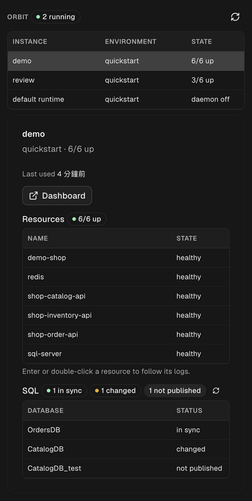

# Orbit for Orca

A read-only Orbit status panel in Orca's right sidebar.



- **Instances**: the default runtime and every named `--instance`. Each has its own daemon;
  State shows `daemon off` or how many resources are up (`2/12 up`). A runtime counts as
  running when at least one resource is up — a daemon alone runs nothing, and the default
  runtime's daemon stays up between sessions. Refreshes every 30 seconds while visible.
- **Resources**: select an instance to see each container and service with its state and
  restarts; a stopped resource names the dependencies it waits on. Enter or double-click a
  resource to open its logs in a terminal tab (Orca switches to it).
- **SQL**: each database of the environment's SQL projects is `in sync`, `changed` (files
  changed since the last publish), `not published` or `unknown`.
- **Dashboard** opens the instance's Orbit dashboard in the browser.

## Read-only

The worker runs only `orbit instance list`, `status`, `inspect`, `sqlserver list`,
`sqlserver diff` and `logs` (`isReadOnly` in `src/orbit.ts`); never `up`, `down`, `restart`,
`publish` or `reset`.

## How SQL status is read

`orbit sqlserver diff` on a database Orbit never published runs the full SqlPackage comparison
(seconds per database). The worker reads `data.publish_records` from the
`orbit sqlserver list --json` call it already makes, and runs the quick diff only for databases
whose `last_publish` is set, so a 22-database environment answers in about 0.2 seconds. An Orbit
CLI too old to report publish records shows every database as `unknown`.

## Orbit version

Orbit 0.16.10 or newer. It reports publish records in `orbit sqlserver list --json`, named
instances' resource counts and last-used time in `orbit instance list --json`, and recent log
lines before `orbit logs <r> -f --lines 200` follows. With older Orbit, SQL status shows
`unknown`, named instances show `daemon up` without counts, and log tabs start empty.

## Develop

```sh
orca plugin test .
orca plugin dev load . --approve <fingerprint>   # edits then hot-reload
orca plugin dev unload .
```

Needs Orca 1.4.247 or newer and `orbit` on PATH. Logs open through Orca's bundled CLI, found
beside the running app (`bin/orca` on macOS, `bin/orca-ide` on Linux), because the plugin
API's `terminal.create` opens a background terminal that never appears on screen.

## Release

```sh
scripts/release.sh 0.1.2
```

It checks that `main` is clean and pushed, that the tag is new, and that the plugin has a licence;
runs the tests; bumps `version` in `orca-plugin.json`; validates; then commits, tags `v0.1.2` and,
after you confirm, pushes the commit and the tag together. The community catalog lists the tag
on its next scan and never accepts a moved tag, so a pushed version is final.

Platforms: macOS verified; Linux coded for but untested; Windows not supported yet (commands
are POSIX-quoted and joined with `;`).
