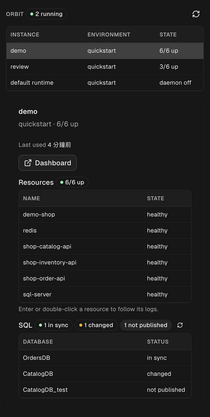

# Orbit for Orca

## What it is

Orbit for Orca is a plugin that adds a read-only Orbit status panel to Orca's right sidebar. It
lists the default runtime and every named `--instance`, shows each one's containers and services
and the status of its SQL projects, and opens a resource's logs in an Orca terminal tab. It reads
Orbit state; it never changes it.

## Requirements

- Orca 1.4.247 or newer.
- Orbit 0.16.10 or newer. Older Orbit works, but SQL status shows `unknown`, named instances
  show `daemon up` without resource counts or last-used time, and log tabs start without recent
  lines.
- The `orbit` CLI on your `PATH`. On macOS and Linux the plugin also looks in the usual install
  locations (Homebrew and `/usr/local/bin`; on Linux also `~/.local/bin`), because Orca started
  from the desktop may not load your shell profile.

Orca's bundled CLI (used to open the log tab) is located automatically from the running app. You
do not need to install it separately.

## Install

### From a Git URL

1. In Orca, open Settings, then Plugins, then Add.
2. Choose "From a Git URL…".
3. Enter `https://github.com/iml885203/orca-orbit` and confirm the plugin's permissions.

### From the marketplace

Orca's community marketplace lists GitHub repositories that have a `v<version>` tag, the
`orca-plugin` topic and a licence. The plugin's page is
`https://www.onorca.dev/plugins/iml885203/orca-orbit`. To browse the marketplace inside Orca, add
it under Settings, then Plugins, then Add marketplace, with URL
`https://github.com/stablyai/orca-community-plugins.git` and ref `main`.

The plugin asks for one capability, `workspace:read`, which it uses to find the workspace that
the log tab opens in.

## What you see

Open the Orbit panel in the right sidebar.



**Instance list.** One row per runtime: the default runtime (labelled "default runtime") and
every named `--instance`. Columns are Instance, Environment and State. State is `daemon off`, or
`N/M up` (resources up out of all resources). A runtime counts as running when at least one
resource is up. A daemon alone runs nothing, and the default runtime's daemon stays up between
sessions. The header shows how many runtimes are running. Running runtimes sort first. The panel
refreshes every 30 seconds while it is visible; the refresh button reloads on demand.

**Runtime details.** Select a runtime to see:

- **Dashboard.** A button that opens the runtime's [Orbit dashboard](https://github.com/iml885203/orbit#dashboard) in your browser.
  It is disabled while the daemon is off.
- **Resources.** Each container and service with its kind, state and restart count. A stopped
  resource shows the dependencies it is waiting on, for example `stopped (needs db)`. Orbit
  reports resources only while the daemon runs, so a runtime with its daemon off shows none.
- **SQL.** For each database of the environment's SQL projects: `in sync`, `changed`,
  `not published` or `unknown`, with a short detail line. See
  [How SQL status is determined](#how-sql-status-is-determined). If the environment does not
  enable the SQL Server workflow, the panel says so.

**Logs.** Press Enter or double-click a resource to open its logs in a visible Orca terminal tab,
named `<instance> · <resource>`. Orca switches to the tab. A workspace must be open in Orca: the
tab opens inside it.

SQL status is checked when you select a runtime and when you press the SQL refresh button, not on
the 30-second refresh, because a check can take seconds.

## Read-only guarantee

The plugin runs only these Orbit commands:

- `orbit instance list`
- `orbit status`
- `orbit inspect`
- `orbit sqlserver list`
- `orbit sqlserver diff`
- `orbit logs`

It never runs `up`, `down`, `restart`, `publish`, `reset` or `clean`. Every command goes through
an allow-list check, and anything else is refused before it starts. The panel has no buttons that
start, stop or delete anything.

To start or stop a runtime, publish a database, or delete an instance, use the Orbit dashboard or
the CLI.

## How SQL status is determined

For each database in the environment's SQL projects (`orbit sqlserver list`), the plugin picks
one of four states:

| Status          | Meaning                                                                      |
| --------------- | ---------------------------------------------------------------------------- |
| `in sync`       | `orbit sqlserver diff <db>` found nothing to change.                         |
| `changed`       | The diff reports source files changed since the last publish, or schema changes. |
| `not published` | Orbit has no publish record for the database.                                |
| `unknown`       | Orbit is older than 0.16.10, or the diff failed. The detail says why.        |

Orbit's [SQL workflow](https://github.com/iml885203/orbit/blob/main/docs/sql-workflow.md) runs a full SqlPackage comparison for a database it never
published, which takes seconds per database. To avoid that, the plugin reads the publish records
that `orbit sqlserver list --json` reports, and runs the quick `diff` only for databases Orbit has
published. Databases
without a record are reported as `not published` without touching SQL Server. Up to four diffs
run at a time.

## Platform support

| Platform | Status                                                                                      |
| -------- | ------------------------------------------------------------------------------------------- |
| macOS    | Verified.                                                                                   |
| Linux    | Coded for, untested. Orca's bundled CLI there is `bin/orca-ide`, and the plugin adds common Linux install directories to `PATH`. |
| Windows  | Not supported yet. The log command is built with POSIX quoting and joined with `;`, which Windows shells do not run the same way. |

## Known limitations

- **A publish record is Orbit's own history, not a live check.** A database changed or dropped
  outside Orbit, or a recreated volume, still shows its last recorded publish; the quick `diff`
  then reports what it finds.
- **The default runtime costs one extra call.** Named instances get their `N/M up` count and
  last-used time from `orbit instance list --json`; the default runtime is not in that list, so
  the plugin asks it with `orbit status`. It has no last-used time.
- **Last used shows in the runtime card**, not as a column: the sidebar is too narrow for it.
- **No lifecycle actions, by design.** The plugin cannot start, stop, restart or delete instances,
  or publish databases. Use the Orbit dashboard or the CLI.
- **Logs need an open workspace** in Orca.


## Troubleshooting

**The panel says "orbit failed".** The message is Orbit's own error or the shell's. Check that
`orbit --version` works in a terminal. If Orbit is installed in an unusual place, add it to the
`PATH` that Orca starts with, or start Orca from a terminal.

**A runtime shows `daemon off`.** Orbit reports resources only while the daemon runs. Start the
runtime with the CLI or the dashboard; the panel picks it up within 30 seconds.

**Every database shows `unknown`.** The detail says why. `Needs Orbit 0.16.10 or later` means
the `orbit` on Orca's `PATH` is too old to report publish records; check `orbit --version`.

**The log tab does not open.** Open a workspace in Orca first. The tab is created inside the
focused workspace.

**The default runtime is not the one you expect.** The plugin runs Orbit from your home
directory and passes the selected environment's config with `-c` (log tabs too, though they open
in a workspace folder), so a project's `orbit.yaml` is never picked up. The default runtime is the
environment you selected with `orbit switch`, the same as in the dashboard.

## Development

The plugin is TypeScript with a worker (`src/worker.ts`) that runs the Orbit commands and a panel
(`src/panel.tsx`). They talk through the contract in `src/protocol.ts`; Orbit parsing and the
read-only allow-list are in `src/orbit.ts`.

```sh
orca plugin test .
orca plugin dev load . --approve <fingerprint>   # edits then hot-reload
orca plugin dev unload .
```

Orca 1.4.247 or newer is required. Logs open through Orca's CLI because the plugin API's
`terminal.create` opens a background terminal that never appears on screen.
